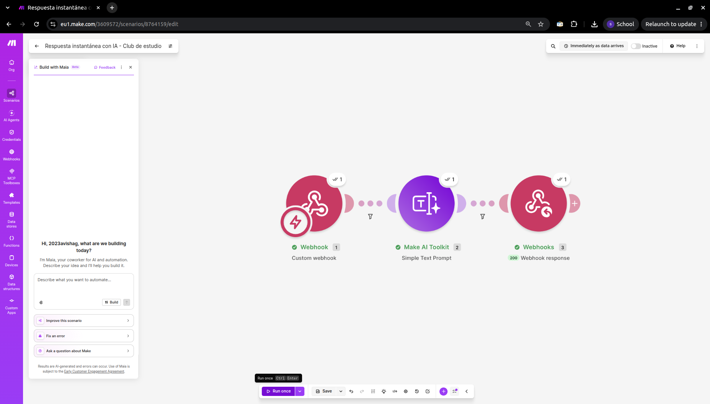

# Respuesta instantánea con IA

Pre-entrega 7 del curso IA Aplicada para 4to Año (Nivel 2).

## Datos generales

| Campo | Detalle |
| --- | --- |
| Estudiante | Avishag Sadrinas |
| Tema | Club de estudio |
| Herramienta | Make |
| Módulo de IA | Make AI Toolkit |
| Escenario | Respuesta instantánea con IA - Club de estudio |
| Documentación | [Página de Notion](https://app.notion.com/p/Respuesta-instantanea-con-IA-Make-421e2addd6a78008ad4dc880e807d9a1?source=copy_link) |

## Objetivo

El escenario recibe una consulta por webhook, la envía a una IA y devuelve una respuesta inmediata. No guarda conversaciones ni datos entre una ejecución y la siguiente.

## Flujo en Make

El escenario tiene exactamente tres módulos:

1. **Webhooks - Custom webhook:** recibe un objeto JSON con el campo `mensaje`.
2. **Make AI Toolkit - Simple Text Prompt:** interpreta la consulta con el prompt del club de estudio.
3. **Webhooks - Webhook response:** devuelve estado `200` y un objeto con el campo `respuesta`.

### Entrada

```json
{
  "mensaje": "Necesito organizar una tarde para estudiar matemática"
}
```

### Salida

```json
{
  "respuesta": "Texto generado para orientar a la persona"
}
```

La URL del webhook no se publica porque pertenece a la conexión privada del escenario.

## Prompt utilizado

```txt
Sos un asistente virtual amable y servicial del club de estudio; respondés siempre de forma clara, natural y breve.

Basate en el mensaje recibido. Debés identificar la necesidad y las preferencias del usuario.

TEMA: club de estudio.

Ofrecé 2 o 3 opciones o respuestas concretas y relevantes, sin usar listas extensas ni explicaciones innecesarias. Si la consulta es ambigua o falta información clave, incluí una sola pregunta al final para orientar la conversación. Devolvé únicamente el mensaje final para el usuario, sin introducciones, metatexto ni explicaciones del sistema.

Mensaje recibido:
{{1.mensaje}}
```

El campo `{{1.mensaje}}` representa el dato que Make mapea desde el primer módulo.

## Prueba realizada

Se envió la consulta de ejemplo mediante una solicitud `POST`.

- El webhook detectó el campo `mensaje`.
- Los tres módulos se ejecutaron correctamente.
- Make AI Toolkit generó una respuesta relacionada con la organización del estudio.
- Webhook Response devolvió estado HTTP `200`.
- El cuerpo recibido pudo validarse como JSON.
- El escenario no utilizó memoria ni almacenamiento.

La respuesta completa está guardada en [`evidencias/respuesta-prueba.json`](evidencias/respuesta-prueba.json).

## Evidencias

### Escenario completo y ejecución exitosa

La captura muestra los tres módulos y una operación exitosa en cada uno.



## Lista de verificación

- [x] El flujo tiene exactamente 3 módulos: Webhook → IA → Webhook Response.
- [x] El prompt utilizado dentro de la IA está registrado en Notion.
- [x] Hay una captura de pantalla del escenario completo armado en Make.
- [x] Hay evidencia de una ejecución exitosa mediante las burbujas verdes.
- [x] La ejecución devolvió una respuesta.
- [x] No se publicaron credenciales ni la URL privada del webhook.

La presentación de esta pre-entrega en Coderhouse queda a cargo de la estudiante.
